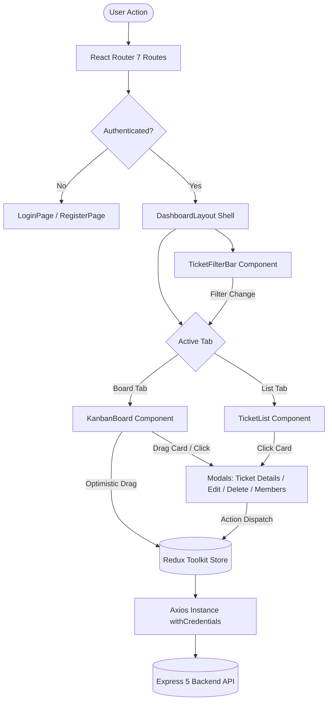

# 🐞 BugBoard — Frontend (Project & Issue Tracker)

A modern, high-performance Issue Tracking and Project Management Single-Page Application built with **React 19**, **Vite**, **Tailwind CSS v4**, **Redux Toolkit**, **React Router 7**, and **@dnd-kit**. Designed around the **Sunset Coral** visual design system, BugBoard delivers interactive drag-and-drop Kanban boards, dual List/Board views, multi-criteria ticket filtering, real-time comment discussion timelines, and role-based workspace management.

---

## 🌐 Live & Local Access

| Environment | Platform | URL |
| :--- | :--- | :--- |
| **Production Preview** | Vercel SPA | [https://project-management-frontend-z4a6.vercel.app](https://project-management-frontend-z4a6.vercel.app) |
| **Local Development** | Vite Dev Server | `http://localhost:5173` |
| **Backend API Server** | Express 5 Server | `http://localhost:3000` |

---

## 📋 Table of Contents

- [Overview](#-overview)
- [Interactive System Flowchart](#-interactive-system-flowchart)
- [Key Features](#-key-features)
- [Component Architecture](#-component-architecture)
- [Folder Structure](#-folder-structure)
- [Tech Stack](#-tech-stack)
- [Design System & Aesthetics](#-design-system--aesthetics)
- [State Management (Redux Toolkit)](#-state-management-redux-toolkit)
- [Routing & Navigation](#-routing--navigation)
- [Installation & Setup](#-installation--setup)
- [Build & Deployment](#-build--deployment)
- [Available Scripts](#-available-scripts)
- [Dependencies](#-dependencies)
- [Interactive Walkthrough & Testing Guides](#-interactive-walkthrough--testing-guides)
- [Authors & License](#-authors--license)

---

## 🔍 Overview

BugBoard eliminates clutter and provides software engineering teams with an intuitive, responsive workspace to report bugs, track feature requests, assign work, and monitor development velocity.

### What It Does
- **Interactive Kanban Board**: Drag tickets smoothly across three status columns (**To do**, **In progress**, **Done**) powered by `@dnd-kit` with optimistic Redux state dispatch and automatic server rollback.
- **Dual Board & List Views**: Switch seamlessly between a tactile visual Kanban layout and a compact list/grid view with synchronized status tabs.
- **Multi-Parameter Search & Filtering**: Instantaneous zero-latency client-side filtering combined with backend query parameter support across status, priority, assignee, and keyword search.
- **Threaded Ticket Comments**: Integrated discussion timeline embedded in ticket details with author avatars, relative timestamps (`Just now`, `5m ago`, `2h ago`), and comment deletion.
- **Role-Based Workspace Governance**: Granular permissions for Project Creators, Admins, Managers, Developers, and Viewers.
- **Sunset Coral Design System**: Warm stone neutrals, vibrant sunset orange primary accents (`#EA580C`), 3px left-edge priority indicator bars, and clean DM Sans typography.

---

## 🔄 Interactive System Flowchart



---

## ✨ Key Features

### 🔐 1. Authentication & Session Management
- **Client-Side Anti-Spam Validation**: Real-time regex verification for full names (letters and spaces only), numeric domain rejections, repeating character checks, and password length enforcement.
- **Redux Auth Slice**: Stores user credentials, active token, and session status.
- **Protected Routing**: `ProtectedRoutes.jsx` automatically redirects unauthenticated users to `/login`, preserving their target destination upon successful login.
- **Axios HTTP Interceptor**: Centrally injects `withCredentials: true` and catches 401 Unauthorized responses to reset authentication state and redirect cleanly.

### 📊 2. Dashboard Layout & Workspace Navigation
- **Responsive Dashboard Shell**: [DashboardLayout.jsx](file:///c:/Users/indra/OneDrive/Documents/PROJECT_MANAGEMENT/frontend/src/layouts/DashboardLayout.jsx) provides a persistent sidebar, top navigation bar, breadcrumb trails, and project switcher dropdown.
- **Mobile Navigation Drawer**: Smooth slide-over menu for small screens.
- **Metrics Overview**: Real-time count of total projects, open tickets, tickets assigned to you, and completed items.

### 👥 3. Project Detail & Member Management
- **Workspace Header**: Displays project title, description, team member counters, and administrative action buttons (**New ticket**, **Edit project**, **Delete project**).
- **Tab Navigation**: Tabbed views for **Board** (Kanban), **List** (Tickets), **Overview** (Scope & metadata), and **Team Members** (Roster).
- **Member Invitations**: Add existing registered users by email with specific role assignments (`admin`, `manager`, `developer`, `viewer`).
- **Inline Validation**: Displays immediate error banners if an email is not registered or the user is already a project member.

### 📋 4. Interactive Kanban Drag-and-Drop Board
- **Three Dedicated Columns**:
  - **To do**: Neutral warm stone accents (`#78716C`, bg `#F5F1EC`, border `#D6D3D1`).
  - **In progress**: Soft sky blue accents (`#0284C7`, bg `#F0F9FF`, border `#BAE6FD`).
  - **Done**: Mint green accents (`#16A34A`, bg `#F0FDF4`, border `#BBF7D0`).
- **Sensor Optimization**: `PointerSensor` configured with `activationConstraint: { distance: 5 }` ensures cards can be clicked to open details without triggering accidental drags.
- **Tactile Drag Feedback**: Floating `DragOverlay` shows a rotated (`rotate-2 scale-[1.02]`), elevated shadow card during motion.
- **Optimistic State Updates**: Dispatches `optimisticUpdateTicketStatus` immediately on drop; automatically triggers `rollbackTicketStatus` if the backend request fails.

### 🔍 5. Dynamic Search & Multi-Filter Bar
- **Keyword Search Bar**: Instant real-time search across ticket titles and descriptions with a one-click `X` clear button.
- **Dropdown Filters**:
  - **Status**: All Statuses, To do, In progress, Done.
  - **Priority**: All Priorities, High, Medium, Low.
  - **Assignee**: All Assignees, Unassigned, or any specific project team member.
- **Active Filter Chips**: Interactive dismissable badges with result counter (e.g., `Showing 3 of 8 tickets`) and a `Reset all` button.

### 💬 6. Ticket Detail Modal & Activity Comments
- **Rich Ticket Inspection**: Click any ticket in Board or List view to inspect full title, description, status, priority, assignee, creator, and creation date.
- **Activity Timeline**: [CommentSection.jsx](file:///c:/Users/indra/OneDrive/Documents/PROJECT_MANAGEMENT/frontend/src/components/comments/CommentSection.jsx) renders chronological comments with author initials, name badges, and relative timestamps (`Just now`, `5m ago`, `2h ago`).
- **Productive Commenting**: Multi-line comment box with `Ctrl+Enter` / `Cmd+Enter` keyboard shortcut and comment author deletion.

### ✏️ 7. Ticket Editing & Deletion
- **Edit Modal**: [EditTicketModal.jsx](file:///c:/Users/indra/OneDrive/Documents/PROJECT_MANAGEMENT/frontend/src/components/tickets/EditTicketModal.jsx) enables editing title, description, priority, status, and assignee with server validation.
- **Delete Modal**: [DeleteTicketModal.jsx](file:///c:/Users/indra/OneDrive/Documents/PROJECT_MANAGEMENT/frontend/src/components/tickets/DeleteTicketModal.jsx) provides a high-visibility warning dialog detailing the permanent cascade removal of all comments.

---

## 🧩 Component Architecture

```
frontend/src/
├── components/
│   ├── auth/
│   │   ├── LoginForm.jsx             # Login credentials form with anti-spam check
│   │   └── RegisterForm.jsx          # User onboarding form with live regex validation
│   ├── comments/
│   │   └── CommentSection.jsx        # Ticket discussion timeline & comment input
│   ├── kanban/
│   │   ├── DoneColumn.jsx            # Droppable 'done' status container
│   │   ├── DraggableTicketCard.jsx   # useSortable card wrapper with pointer constraints
│   │   ├── InProgressColumn.jsx      # Droppable 'in_progress' status container
│   │   ├── KanbanBoard.jsx           # DndContext orchestrator & DragOverlay
│   │   ├── KanbanCard.jsx            # Visual card with 3px priority left-edge bar
│   │   └── TodoColumn.jsx            # Droppable 'todo' status container
│   ├── layout/
│   │   ├── Breadcrumbs.jsx           # Hierarchical navigation breadcrumb
│   │   ├── ProjectSelector.jsx       # Quick project switcher dropdown
│   │   ├── Sidebar.jsx               # Responsive navigation sidebar
│   │   └── Topbar.jsx                # Header bar with user profile & mobile toggle
│   ├── projects/
│   │   ├── AddMemberModal.jsx        # Member invitation dialog with role picker
│   │   ├── CreateProjectModal.jsx    # Project creation modal
│   │   ├── EditProjectModal.jsx      # Project metadata editor
│   │   └── ProjectCard.jsx           # Dashboard project overview card
│   ├── tickets/
│   │   ├── CreateTicketModal.jsx     # New ticket creation modal
│   │   ├── DeleteTicketModal.jsx     # Destructive confirmation popup
│   │   ├── EditTicketModal.jsx       # Comprehensive ticket editor dialog
│   │   ├── TicketCard.jsx            # List view ticket card
│   │   ├── TicketDetailModal.jsx     # Full ticket view & comments host
│   │   ├── TicketFilterBar.jsx       # Search & multi-parameter dropdown filter bar
│   │   └── TicketList.jsx            # Filtered tickets list & empty state
│   └── ProtectedRoutes.jsx           # Client-side authentication route guard
├── https/
│   └── axios.js                      # Axios instance with credentials & 401 interceptor
├── layouts/
│   └── DashboardLayout.jsx           # Primary responsive layout container
├── pages/
│   ├── DashboardPage.jsx             # Main dashboard metrics & recent tickets
│   ├── LoginPage.jsx                 # Public user sign-in page
│   ├── ProfilePage.jsx               # User profile info & session details
│   ├── ProjectDetailPage.jsx         # Project workspace (Board, List, Members)
│   ├── ProjectsPage.jsx              # Project directory & creation trigger
│   └── RegisterPage.jsx              # Public registration page
├── redux/
│   ├── slices/
│   │   ├── authSlice.js              # User authentication, tokens & session state
│   │   ├── commentSlice.js           # Ticket comments dictionary by ticketId
│   │   ├── projectSlice.js           # Projects directory & active project
│   │   └── ticketSlice.js            # Tickets list, filters, Kanban optimistic updates
│   └── store.js                      # Central Redux store configuration
├── App.jsx                           # Route declarations & global ToastContainer
├── index.css                         # Tailwind CSS v4 directives & theme styles
└── main.jsx                          # React 19 application root
```

---

## 📂 Folder Structure

```
frontend/
├── dist/                     # Optimized production bundle assets
├── public/                   # Static public assets
├── src/                      # Source code (Components, Pages, Redux, Layouts)
├── .env                      # Environment configuration (VITE_API_URL)
├── .gitignore                # Git ignore configuration
├── eslint.config.js          # ESLint flat configuration
├── index.html                # HTML5 entry shell
├── package.json              # Frontend dependencies and build scripts
├── vercel.json               # Vercel Single-Page Application rewrites
└── vite.config.js            # Vite build configuration with React & Tailwind plugins
```

---

## 🛠️ Tech Stack

| Technology | Version | Category | Purpose |
| :--- | :--- | :--- | :--- |
| **React** | `^19.3.1` | UI Framework | Concurrent component rendering & modern hooks (`useMemo`, `useState`) |
| **Vite** | `^8.3.5` | Bundler | Next-generation frontend tooling with instant Hot Module Replacement |
| **Tailwind CSS** | `^4.3.5` | Styling | Utility-first CSS engine via `@tailwindcss/vite` |
| **Redux Toolkit** | `^2.14.0` | State Store | Centralized state management with async thunks and optimistic reducers |
| **React Redux** | `^9.3.1` | State Connector | Official React bindings for Redux |
| **React Router DOM** | `^7.18.5` | Routing | Declarative client-side routing, protected routes, and URL params |
| **@dnd-kit/core** | `^6.3.1` | Drag & Drop | Accessible, lightweight drag-and-drop primitives |
| **@dnd-kit/sortable**| `^10.0.0` | Drag & Drop | Sortable lists and column droppables |
| **@dnd-kit/utilities**| `^3.2.2` | Drag & Drop | CSS transform and coordinate utilities |
| **Axios** | `^1.21.1` | HTTP Client | Promise-based HTTP client with cookie credentials & interceptors |
| **Lucide React** | `^1.73.0` | Icons | Clean, consistent SVG icon set |
| **React Toastify** | `^11.2.0` | Notifications | Responsive toast alert notifications |

---

## 🎨 Design System & Aesthetics

BugBoard is crafted around the **Sunset Coral** visual identity specified in `DESIGN.md`:

### Core Color Palette

| Token Name | Hex Code | Visual Swatch | Application |
| :--- | :--- | :--- | :--- |
| **Coral Primary** | `#EA580C` | `rgb(234, 88, 12)` | Primary CTA buttons, active tabs, brand icons |
| **Coral Hover** | `#C2410C` | `rgb(194, 65, 12)` | Button hover states, highlighted navigation items |
| **Coral Soft** | `#FFEDD5` | `rgb(255, 237, 213)` | Avatar background, selected badges, subtle highlights |
| **Warm Sand Light**| `#FAF5EE` | `rgb(250, 245, 238)` | App background, subtle card containers |
| **Stone Dark** | `#292524` | `rgb(41, 37, 36)` | Primary headings, card titles, high-contrast labels |
| **Stone Muted** | `#78716C` | `rgb(120, 113, 108)` | Secondary text, date stamps, breadcrumbs |
| **Border Neutral** | `#F5E6D3` | `rgb(245, 230, 211)` | Card borders, table dividers, panel strokes |

### Status Badges

| Status | Badge Classes | Icon | Accent Top Bar |
| :--- | :--- | :--- | :--- |
| **To do** | `bg-[#F0EBE4] text-[#44403C] border-[#D6D3D1]` | `Circle` | `#78716C` (Warm stone) |
| **In progress** | `bg-[#E0F2FE] text-[#075985] border-[#BAE6FD]` | `Clock` / `Loader` | `#0284C7` (Sky blue) |
| **Done** | `bg-[#DCFCE7] text-[#166534] border-[#BBF7D0]` | `CheckCircle2` | `#16A34A` (Mint green) |

### Priority Indicators & 3px Left Edges

| Priority | Edge Border Class | Badge Colors | Icon |
| :--- | :--- | :--- | :--- |
| **High** | `border-l-[#EF4444]` (Red) | `bg-[#FEE2E2] text-[#991B1B] border-[#FECACA]` | `ArrowUp` |
| **Medium** | `border-l-[#FBBF24]` (Amber) | `bg-[#FEF3C7] text-[#92400E] border-[#FDE68A]` | `Minus` |
| **Low** | `border-l-[#4ADE80]` (Green) | `bg-[#DCFCE7] text-[#166534] border-[#BBF7D0]` | `ArrowDown` |

---

## 📦 State Management (Redux Toolkit)

Global state is organized into four slices in `frontend/src/redux/slices/`:

### 1. `authSlice.js`
- **State**: `user` (Object | null), `token` (String | null), `isAuthenticated` (Boolean), `loading` (Boolean), `error` (String | null).
- **Thunks**: `registerUser`, `loginUser`, `logoutUser`, `checkAuth`.

### 2. `projectSlice.js`
- **State**: `projects` (Array), `currentProject` (Object | null), `loading` (Boolean), `error` (String | null).
- **Thunks**: `fetchProjects`, `fetchProjectById`, `createProject`, `updateProject`, `deleteProject`, `addProjectMember`, `removeProjectMember`.

### 3. `ticketSlice.js`
- **State**: `tickets` (Array for active project), `userTickets` (Array across projects), `loading` (Boolean), `error` (String | null).
- **Thunks**: `fetchTicketsByProject`, `fetchUserTickets`, `createTicket`, `updateTicket`, `deleteTicket`.
- **Synchronous Reducers**: `optimisticUpdateTicketStatus` (instantly updates card status), `rollbackTicketStatus` (reverts status if API fails).

### 4. `commentSlice.js`
- **State**: `commentsByTicket` (Dictionary: `{ [ticketId]: Array<Comment> }`), `loading` (Boolean), `submitting` (Boolean), `error` (String | null).
- **Thunks**: `fetchComments`, `addComment`, `deleteComment`.
- **Synchronous Reducers**: `clearTicketComments`, `clearCommentError`.

---

## 🗺️ Routing & Navigation

| Path | View / Component | Auth Required | Description |
| :--- | :--- | :---: | :--- |
| `/login` | `LoginPage.jsx` | ❌ | User sign-in portal; redirects to `/` if authenticated |
| `/register` | `RegisterPage.jsx` | ❌ | User onboarding portal; redirects to `/` if authenticated |
| `/` or `/dashboard` | `DashboardPage.jsx` | ✅ | Central workspace metrics, active projects & assigned tickets |
| `/projects` | `ProjectsPage.jsx` | ✅ | Project directory cards and workspace creation modal |
| `/projects/:projectId` | `ProjectDetailPage.jsx` | ✅ | Project workspace with **Board**, **List**, **Overview**, & **Members** |
| `/profile` | `ProfilePage.jsx` | ✅ | User profile information and session management |
| `*` | `Navigate` redirect | — | Catch-all redirect to `/` |

---

## 🚀 Installation & Setup

### Prerequisites
- **Node.js**: `v18.x` or higher
- **npm**: `v9.x` or higher
- **Running Backend Server**: BugBoard Express backend running on port 3000

### Step-by-Step Instructions

```bash
# 1. Navigate to the frontend directory
cd frontend

# 2. Install dependencies
npm install

# 3. Configure environment variables (.env)
cp .env.example .env # or create .env directly
```

#### Sample `.env` Configuration
```env
VITE_API_URL=http://localhost:3000
```

```bash
# 4. Start local development server with Vite HMR
npm run dev
```

The application will launch on: **`http://localhost:5173`**

---

## 🏗️ Build & Deployment

### Production Compilation
```bash
npm run build
```
Generates minified, tree-shaken production assets inside `frontend/dist/`.

### Deploying to Vercel
1. Connect your repository to the **Vercel Dashboard**.
2. Set **Root Directory** to `frontend`.
3. Set **Framework Preset** to `Vite`.
4. Configure environment variable: `VITE_API_URL=https://your-backend-domain.com`.
5. Deploy! The included `frontend/vercel.json` ensures client-side routes redirect cleanly to `/index.html`:

```json
{
  "rewrites": [
    {
      "source": "/(.*)",
      "destination": "/index.html"
    }
  ]
}
```

---

## 📜 Available Scripts

| Command | Action |
| :--- | :--- |
| `npm run dev` | Starts Vite development server with instant HMR on `localhost:5173` |
| `npm run build` | Compiles optimized production bundle in `dist/` |
| `npm run preview` | Locally serves production build for pre-deployment inspection |
| `npm run lint` | Runs ESLint analysis across all project files |

---

## 📦 Dependencies

```json
{
  "dependencies": {
    "@dnd-kit/core": "^6.3.1",
    "@dnd-kit/sortable": "^10.0.0",
    "@dnd-kit/utilities": "^3.2.2",
    "@reduxjs/toolkit": "^2.14.0",
    "@tailwindcss/vite": "^4.3.5",
    "axios": "^1.21.1",
    "lucide-react": "^1.73.0",
    "react": "^19.3.1",
    "react-dom": "^19.3.1",
    "react-redux": "^9.3.1",
    "react-router-dom": "^7.18.5",
    "react-toastify": "^11.2.0",
    "tailwindcss": "^4.3.5"
  },
  "devDependencies": {
    "@eslint/js": "^10.0.1",
    "@types/react": "^19.3.0",
    "@types/react-dom": "^19.3.0",
    "@vitejs/plugin-react": "^6.1.2",
    "eslint": "^10.13.0",
    "eslint-plugin-react-hooks": "^7.1.1",
    "eslint-plugin-react-refresh": "^0.5.7",
    "globals": "^17.13.0",
    "vite": "^8.3.5"
  }
}
```

---

## 💡 Interactive Walkthrough & Testing Guides

### 🧪 End-to-End User Testing Checklist

1. **User Onboarding**: Navigate to `/register` and create an account. Verify anti-spam rules reject invalid patterns.
2. **Login & Session**: Sign in with your credentials. Verify JWT token is stored and dashboard loads.
3. **Create Project**: Click **New Project**, enter a title and description, and submit.
4. **Invite Team Members**: Open the project, switch to the **Team Members** tab, click **Add Member**, enter an existing user's email, and select a role (`Developer`, `Manager`, `Viewer`).
5. **Create Tickets**: Click **New Ticket** or click the `+` button on any Kanban column to create a ticket with priority and assignee.
6. **Drag-and-Drop Kanban**: Drag a ticket from **To do** to **In progress** or **Done**. Observe smooth physics, elevated shadow, and status badge updates.
7. **Filter & Search**: Type a keyword into the search bar. Use the Status, Priority, and Assignee dropdowns. Notice zero-latency filtering and the result counter.
8. **Inspect Ticket & Comment**: Click any ticket card to open the **Ticket Detail Modal**. Add a comment using `Ctrl+Enter` and see the timeline update.
9. **Edit Ticket**: Click the edit icon to modify title, description, priority, or assignee.
10. **Delete Ticket**: Click the delete icon, confirm the warning dialog, and verify the ticket is removed and associated comments are cleaned up.

---

## 👥 Authors & License

**BugBoard Development Team**  
License: **ISC**
